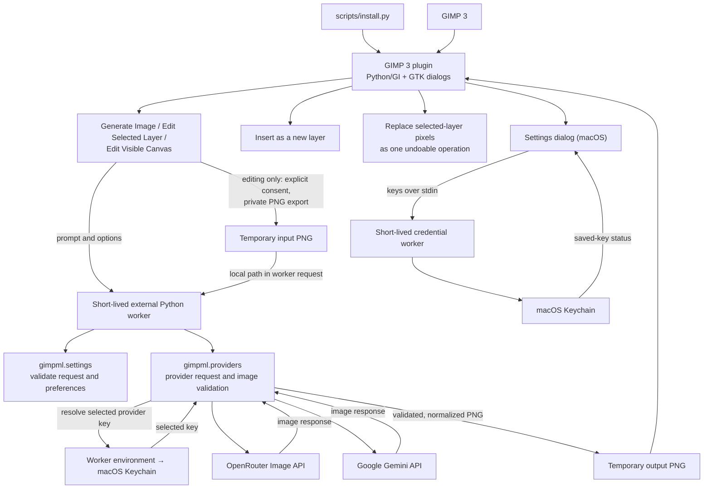

# GIMP-ML: image generation and editing

Generate and edit images in **GIMP 3** using Gemini models through **OpenRouter**
or **Google**. Native dialogs live under **Filters > GIMP-ML**; no local models,
GPU, or separate UI application are needed. Results become new layers by default,
with optional undoable pixel replacement.

## Plugin UI and generated output


Earlier generation dialog in GIMP 3.2.4 on macOS: "coffee mug in ice" via
OpenRouter, `gemini-2.5-flash-image`, 1:1, 1K. The current version has separate
generation/editing commands and macOS Settings.

## Install

Requirements: GIMP 3.0 or newer, a separate Python 3.10+ installation with
`venv`/`pip`, internet access, and a funded API account.

### macOS disk image

On macOS 13 or newer, open `GIMP-ML-macOS.dmg`, fully quit GIMP (**Cmd+Q**), and
double-click **Install GIMP-ML**. If GIMP is not in `/Applications/GIMP.app`, use
**Choose GIMP...** to select it. Python from Homebrew or python.org must already be installed;
setup downloads dependencies and does not install Python itself.

The native installer contains an **interactive terminal** and an animated progress
bar in one window; it does not launch Terminal.app. Output is streamed to the
embedded terminal and the installation log. **Ctrl+C** interrupts setup.
After setup finishes, the terminal becomes an interactive Bash shell for commands;
click **Done** to close it before ejecting the disk image. Download times vary,
so the progress bar is indeterminate rather than claiming a percentage.

The installer:

- Copies the backend to `~/Library/Application Support/GIMP-ML` and creates its
  isolated `.venv`, so the disk image can be ejected after installation.
- Queries GIMP 3 for its actual user plugin directory (including version-specific
  directories such as `3.0` or `3.2`) and installs the plugin there.
- Adds that directory to GIMP's **Preferences > Folders > Plug-ins** search path
  only if it is missing, preserving other entries and saving the original
  preferences as `gimprc.gimpml-backup` before the first change.
- Requires no administrator password and does not modify GIMP.app or save API keys.
  The running-GIMP check applies only to the installing user, not other accounts.

Reopen GIMP and use **Filters > GIMP-ML > Settings...** to save your API key.
Rerun the installer for updates or after switching GIMP versions. Errors are
recorded in `~/Library/Logs/GIMP-ML/install.log` and shown in the embedded terminal
on failure. To uninstall, remove `gimpml-gemini` from the discovered user plugin
directory and remove `~/Library/Application Support/GIMP-ML`. The standard user
plugin search path should remain in GIMP's preferences.

This build is ad-hoc signed, **not Developer ID signed or notarized**. macOS may
block a downloaded copy; only for a build you trust, use **System Settings >
Privacy & Security > Open Anyway**. Public distribution without this warning
requires Developer ID signing and Apple notarization.

### Source installation

```sh
python3 scripts/install.py
```

The installer creates `.venv` and copies the plugin to GIMP's user plugin
directory without modifying GIMP's bundled Python or other plugins.
For custom paths:

```sh
python3 scripts/install.py --gimp "/path/to/gimp"
# Or bypass discovery:
python3 scripts/install.py --plug-in-dir "/your/GIMP/plug-ins"
```

**Rerun the installer after moving the repository or updating plugin code.**
Then fully quit GIMP (**Cmd+Q** on macOS) and reopen it; closing a dialog alone
does not refresh the installed plugin.

To use a permanent backend location and automatic search-path registration from
the command line on macOS (with GIMP fully closed):

```sh
python3 scripts/install.py \
  --runtime-dir "$HOME/Library/Application Support/GIMP-ML" \
  --register-plugin-path
```

## Credentials

On macOS, open **Filters > GIMP-ML > Settings...**, enter a provider key, and
click **Save** to store it in Keychain. Each field has a clickable key-creation
guide. Saved keys are never displayed: leave a field blank to keep its key, or
check **Remove saved** with the field blank to delete it. Changes apply immediately;
saving does not verify account access or credits.

Alternatively, set the selected provider's key in GIMP's inherited environment
(required on other platforms):

```sh
export OPENROUTER_API_KEY=your-openrouter-key
export GEMINI_API_KEY=your-google-api-key
```

Only one provider key is needed; Google also accepts `GOOGLE_API_KEY`.
**Environment variables override Keychain** and are not removed by Settings.
Use Keychain when GIMP does not inherit your terminal environment. `.env` files
are no longer read; never put keys into [`gimpml/config.json`](gimpml/config.json).

Key-creation guides (also shown when a key is missing):
[OpenRouter](https://www.apideck.com/blog/how-to-get-your-openrouter-api-key) ·
[Gemini](https://www.merge.dev/blog/gemini-api-key).

## Use

The following commands are available under **Filters > GIMP-ML**:

| Command | Purpose | Requires an open image |
| --- | --- | --- |
| **Generate Image...** | Text-only generation without image upload | No |
| **Edit Selected Layer...** | Edit one layer using a text prompt | Yes |
| **Edit Visible Canvas...** | Edit the visible canvas composite | Yes |
| **Settings...** (macOS only) | Save or remove provider API keys in Keychain | No |

Choose a command, enter a prompt, select the provider/model/size, and click
**Generate** or **Apply Edit**. Editing requires RGB or grayscale, plus explicit
upload consent each time the dialog opens.

- **Generation:** creates a new top layer, or a document if none is open.
  **Fit image within canvas** scales and centers without stretching or resizing
  the canvas; otherwise native output size is kept.
- **Layer editing:** requires one ordinary layer. Uploads its pixels, including
  those outside the canvas, without its opacity, blend mode, or mask.
- **Canvas editing:** uploads the visible composite within canvas bounds.
- **Output:** new layers preserve originals. Optional replacement requires an
  unlocked selected layer (content/alpha) and unlocked parent-group content.
  It preserves layer properties and masks, respects the selection, and is undoable.
  Canvas replacement crops the composite to the target layer; new layers are not
  selection-clipped.

Edited results fit the input bounds without stretching, with transparent padding
if needed. Inputs are limited to **12 MiB / 32 million pixels**; metadata is
removed before upload. Editing is a whole-image operation, not a guaranteed
pixel-preserving change, even with a selection.

`gemini-2.5-flash-image` supports 1K only; the other offered models support
1K/2K/4K. Defaults and the 10–600 second timeout are in
[`gimpml/config.json`](gimpml/config.json).

**Privacy and billing:** prompts go to the selected external provider; images
are uploaded only for editing with consent. API use may incur charges.
Cancellation prevents local changes but may not stop provider processing or
billing. There are no automatic retries, provider switching, or stored conversations.

## Architecture



GIMP's Python/GI plugin launches short-lived workers using `requests`, `Pillow`,
and macOS `keyring`. JSON travels over stdin/stdout; images use private temporary
files. Keys never appear in command-line arguments or logs. Responses are
validated, errors sanitized, and temporary files cleaned up on all outcomes.
No persistent server or localhost port is used.

## Development and validation

Build the lightweight, Intel/Apple Silicon macOS installer on macOS:

```sh
python3 scripts/build_dmg.py
# Or choose a different output file:
python3 scripts/build_dmg.py --output /path/to/GIMP-ML-macOS.dmg
```

This requires Xcode with Swift 6.2+ and uses Swift Package Manager, `codesign`,
and `hdiutil`. The first build downloads the pinned MIT-licensed
[SwiftTerm](https://github.com/migueldeicaza/SwiftTerm) terminal component;
its license is included in the app. The DMG contains the native installer
and source payload, not your environment, credentials, or existing virtualenv.
It does not bundle Python or Python dependencies. Existing output files are not overwritten.

```sh
.venv/bin/python -m unittest discover -s tests -v
```

On macOS, run the **offline** GIMP integration test:

```sh
/Applications/GIMP.app/Contents/MacOS/gimp \
  -n -d -f -s -c --batch-interpreter=python-fu-eval \
  -b "exec(open('$(pwd)/tests/gimp_smoke.py').read())" --quit
```

Tests use mocked HTTP responses and local image fixtures, with no paid API calls.
The integration test opens a temporary graphical GIMP instance to check dialogs,
credentials, worker transport, cancellation, generation, and editing.

The three procedures are also available noninteractively:

- `python-fu-gimpml-generate`
- `python-fu-gimpml-edit-layer`
- `python-fu-gimpml-edit-canvas`

All accept `prompt`, `provider`, `model`, `aspect-ratio`, and `resolution`.
Generation adds `fit-to-canvas`; editing adds `output-mode` (`new-layer` or
`replace-layer`) and `allow-image-upload` (must be `true`).
The legacy combined `python-fu-gimpml-gemini` procedure is no longer available.

## License and citation

The project is [MIT licensed](LICENSE.md). Provider terms apply to API use
and generated images. Google-generated images may include SynthID watermarks.

This paper describes the legacy computer-vision plugins, not the current GIMP 3
implementation:

```bibtex
@article{soman2020GIMPML,
  title={GIMP-ML: Python Plugins for using Computer Vision Models in GIMP},
  author={Soman, Kritik},
  journal={arXiv preprint arXiv:2004.13060},
  year={2020}
}
```
