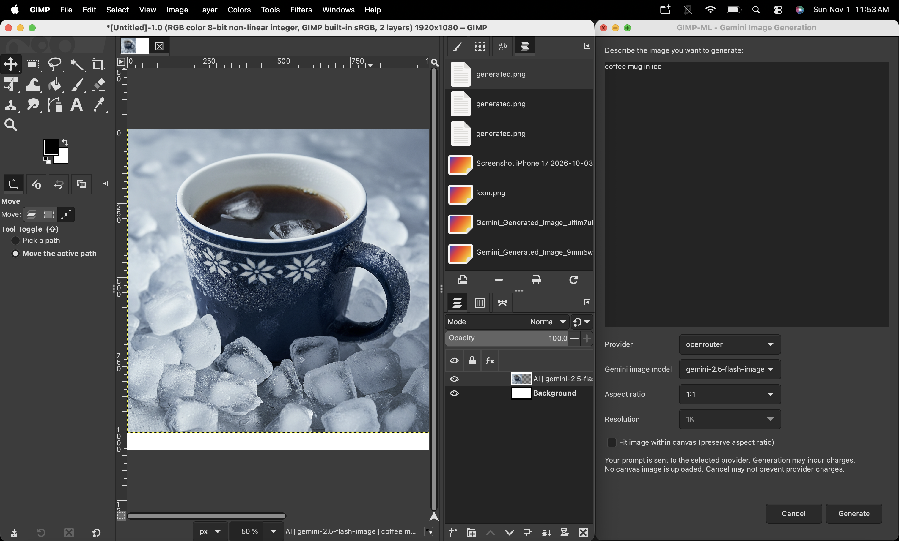

# GIMP-ML: image generation and editing

**GIMP-ML brings text-driven image creation and editing directly into GIMP 3.**
Create an image from a description, transform a selected layer, or rework the
visible canvas without leaving your editor. Native dialogs under
**Filters > GIMP-ML** connect to **OpenRouter** or **Google**; no local models,
GPU, or separate UI application are required.

- **Generate Image**: turn a text prompt into a new image or document layer.
- **Edit Selected Layer**: describe changes to one layer's pixels.
- **Edit Visible Canvas**: use the visible composition as the editing input.
- **Settings** (macOS): manage provider API keys in OS-protected Keychain storage.

Results are added as a **new layer by default**, preserving your originals.
Editing can optionally replace selected-layer pixels with **undo support**.
Text-only generation sends only your prompt; editing requires explicit consent
to upload the chosen image. Both use external APIs and may incur charges.

This implementation replaces the legacy GIMP 2/Python 2 plugins, local
computer-vision models, OpenAI-only pipelines, and Qt tray application.

## Plugin UI and generated output



Native plugin dialog and generated output captured in GIMP 3.2.4 on macOS.
The prompt "coffee mug in ice" uses `gemini-2.5-flash-image` via OpenRouter
with a 1:1 aspect ratio and 1K resolution. The generated image appears as a
new layer above the existing Background layer, alongside the plugin controls.
This screenshot shows an earlier text-only generation dialog. The current version
has three separate image commands with provider-neutral titles, plus a
**Settings...** command on macOS. The screenshot does not show the Settings dialog.

## Install

Requirements: GIMP 3.0 or newer, a separate Python 3.10+ installation with
`venv`/`pip`, internet access, and a funded API account.

From this repository:

```sh
python3 scripts/install.py
```

This creates `.venv`, installs the backend dependencies, and copies the
plugin into your user's GIMP plugin directory, discovered from GIMP itself.
For GIMP 3.2 on macOS, this is
`~/Library/Application Support/GIMP/3.2/plug-ins`. It does not modify
`/Applications/GIMP.app` or install packages into GIMP's bundled Python.
For a custom installation:

```sh
python3 scripts/install.py --gimp "/path/to/gimp"
# Or bypass discovery:
python3 scripts/install.py --plug-in-dir "/your/GIMP/plug-ins"
```

Keep this repository at its installed location: the plugin records its
absolute path. Run the installer again after moving it or updating plugin code.
Fully quit GIMP and reopen it after installation to refresh its menus and dialogs.
The installer only replaces its own `gimpml-gemini` plugin; it does not delete
other user-installed plugins. That installed entry point registers all three
image commands and, on macOS, Settings; no separate installation is needed
for each command.

### Quick start on macOS

1. Run the installer above.
2. Fully quit GIMP with **Cmd+Q**, then reopen it.
3. Open **Filters > GIMP-ML > Settings...**, enter a provider's API key, and click
   **Save**. A repository `.env` file is not required when using saved keys.
4. Choose **Generate Image...**, **Edit Selected Layer...**, or **Edit Visible
   Canvas...** from the same menu and select the matching provider.

## Credentials

### Set keys inside GIMP on macOS

1. Choose **Filters > GIMP-ML > Settings...**. No open document is needed.
2. Enter an **OpenRouter API key**, a **Google API key**, or both in the masked fields.
3. Click **Save**. Keys are stored in **macOS Keychain**, not in the project or
   GIMP's procedure settings. macOS may ask you to unlock Keychain or allow access.

Saved keys are never displayed; the dialog only shows whether each provider has
a saved key. Leave a field blank to keep its existing key. To delete one, check
**Remove saved** and leave its field blank. Changes apply to the next API request
without restarting GIMP. Saving does not verify account access or credits.

Credential precedence is: **worker environment variables > macOS Keychain > .env**.
Removing a Keychain entry does not remove credentials from the environment or
`.env`. Settings is macOS-only; other platforms continue to use the options below.
Keychain access errors are shown explicitly, not bypassed using a different key.

### Environment variables or a credentials file

Create `.env` in the repository root, or keep your existing one:

```dotenv
OPENROUTER_API_KEY=your-openrouter-key
GEMINI_API_KEY=your-google-api-key
```

Only the key for the selected provider is needed. Google also accepts
`GOOGLE_API_KEY`. Worker environment variables take precedence over saved keys and `.env`.
The worker explicitly locates `.env`, so GIMP launched from Finder does not
need your terminal's environment.

**Do not put keys into `gimpml/config.json`.** `.env` files are ignored by Git.
Keys stay in the external API worker and are not written to layer names or logs.

## Use

The following commands are available under **Filters > GIMP-ML**:

| Command | Purpose | Requires an open image |
| --- | --- | --- |
| **Generate Image...** | Text-only generation without image upload | No |
| **Edit Selected Layer...** | Edit one layer using a text prompt | Yes |
| **Edit Visible Canvas...** | Edit the visible canvas composite | Yes |
| **Settings...** (macOS only) | Save or remove provider API keys in Keychain | No |

Each command has its own dialog with a fixed image input. Generation is available
without an open document; the editing commands require an open RGB or grayscale image.

### Generate an image from text

1. Fully quit and reopen GIMP after installation.
2. Open a document, or generate without an open document to create one.
3. Choose **Filters > GIMP-ML > Generate Image...**.
4. Enter a prompt, such as "A cinematic mountain landscape at sunset."
5. Choose the provider, image model, aspect ratio, and resolution.
6. Click **Generate**. The generated image appears as a new top layer.

Native output size is preserved by default. **Fit image within canvas** scales
and centers the new layer while preserving aspect ratio; it does not resize
the canvas or stretch the image. Insertion into an existing document is one
undo operation.

### Edit an existing image with text

1. Open an RGB or grayscale document.
2. Choose **Filters > GIMP-ML > Edit Selected Layer...** or
   **Edit Visible Canvas...**.
   Selected-layer editing requires exactly one ordinary layer, not a group or
   layer mask. It uploads that layer's pixels, including pixels outside the canvas,
   without applying its opacity, blend mode, or mask. Visible-canvas editing uploads
   the visible composite within the canvas bounds; hidden layers are not included.
3. Describe the change, for example "Turn the coffee mug red, keeping the ice."
4. Keep **Add a new layer** to preserve originals, or choose **Replace selected
   layer pixels**. Replacement requires one selected layer with unlocked content
   and alpha; its parent groups must also have unlocked content.
5. Check **I allow uploading this image to the selected provider for editing**,
   then click **Apply Edit**. Consent is unchecked each time an editing dialog opens.

Edited results are scaled to fit within the input bounds without stretching,
centered, and padded with transparency if the provider changes the aspect ratio.
Selected-layer results retain the input layer's position; canvas results use the
canvas bounds. **Fit image within canvas** applies only to text-only generation.

Replacement changes the selected layer's pixels in one undo operation, retaining
its identity, name, dimensions, offsets, opacity, blend mode, visibility, and mask.
When editing the visible canvas, replacement crops the edited composite to the
selected layer's bounds. That composite can include other layers' appearance;
adding a new layer is generally preferable. Masks, opacity, and blend modes still
apply to replacement pixels. Editing is a whole-image model operation, not a
guaranteed pixel-preserving edit: the entire chosen input is uploaded even if a
selection exists. Replacement respects the current GIMP selection when applying
pixels; new-layer output is not clipped to that selection. Layers without alpha
receive an alpha channel in the same undo operation so transparent padding can
be represented.

Input PNGs are limited to 12 MiB and 32 million pixels. Reduce the source image
size if it exceeds these limits. Exported image metadata is removed before upload.
Temporary exports are deleted on success, failure, or cancellation. Provider
support and output fidelity vary; unsupported requests produce an explicit error.

### Models and image settings

The **Gemini image model** option selects the model used by each command.
RGB and grayscale documents are supported; indexed documents are not supported.

`gemini-2.5-flash-image` supports 1K output only. The other offered image models
support 1K, 2K, and 4K. Provider/model availability and supported capabilities
can change; an unavailable model produces an explicit error, not a fallback.
OpenRouter uses provider-prefixed model IDs internally; Google uses bare IDs.
Defaults and a 10-600 second timeout are configured in
[`gimpml/config.json`](gimpml/config.json).

Your **prompt** is sent to the selected external provider. Text-only generation
does not upload your canvas or layers. Editing also sends the chosen layer or
visible canvas after explicit upload consent. No conversation history is kept.
Generation and editing can incur charges. Cancellation stops the
local worker and prevents layer insertion or pixel replacement, but cannot guarantee the provider
stops processing or charging. No automatic retries or provider switching occur.

## Architecture

```text
GIMP 3 / three menu commands with dedicated GTK dialogs
    -> optional private PNG export for editing
    -> short-lived Python worker (JSON and local image paths over stdin/stdout)
        -> OpenRouter Image API or Google generateContent
        -> validated PNG in a private temporary directory
    -> new layer or undoable selected-layer pixel replacement
```

The native plugin uses GIMP's Python/GI runtime and standard library only.
The separate worker uses `requests`, `Pillow`, and `python-dotenv`, plus `keyring`
on macOS for OS-protected credential storage. Settings passes new keys to a
short-lived worker over stdin, never as command-line arguments, and receives
only saved-key status in response. A persistent
HTTP server, localhost port, separate UI application, and GPU are unnecessary.
API errors are sanitized, response sizes are bounded, and temporary files are
removed on success, cancellation, or failure.

## Development and validation

```sh
.venv/bin/python -m unittest discover -s tests -v
```

On macOS, run the **offline** GIMP integration test:

```sh
/Applications/GIMP.app/Contents/MacOS/gimp \
  -n -d -f -s -c --batch-interpreter=python-fu-eval \
  -b "exec(open('$(pwd)/tests/gimp_smoke.py').read())" --quit
```

Provider tests mock HTTP responses; the GIMP test uses a local fixture and makes
no paid API requests. It checks registration, worker transport, native dialog
generation/cancellation, RGB/grayscale layer insertion, fitting, and new documents.
Editing checks cover layer/canvas export, upload consent, reference transport,
and pixel replacement while preserving layer properties and masks.
Tests do not prove live API account access or billing.
The integration test opens a temporary GIMP instance because dialogs and new
document displays cannot be tested with the console-only executable.

The three procedures are also available noninteractively:

- `python-fu-gimpml-generate`
- `python-fu-gimpml-edit-layer`
- `python-fu-gimpml-edit-canvas`

All accept `prompt`, `provider`, `model`, `aspect-ratio`, and `resolution`.
Generation additionally accepts `fit-to-canvas`. The editing procedures instead
accept `output-mode` (`new-layer` or `replace-layer`) and `allow-image-upload`
(default `false`, must be `true` to edit). Each procedure fixes its input mode;
there is no `input-mode` argument. The former combined `python-fu-gimpml-gemini`
procedure has been removed; scripts must migrate to the appropriate new procedure.
All three share one installed Python entry point and the same backend.

## License and citation

The project remains [MIT licensed](LICENSE.md). Provider terms apply to API use
and generated images. Google-generated images may include SynthID watermarks.

The paper cited below describes the project's legacy computer-vision plugins
and models, which have been dropped from the current implementation. It does
not describe the current GIMP 3 image-generation and editing plugins.

```bibtex
@article{soman2020GIMPML,
  title={GIMP-ML: Python Plugins for using Computer Vision Models in GIMP},
  author={Soman, Kritik},
  journal={arXiv preprint arXiv:2004.13060},
  year={2020}
}
```
