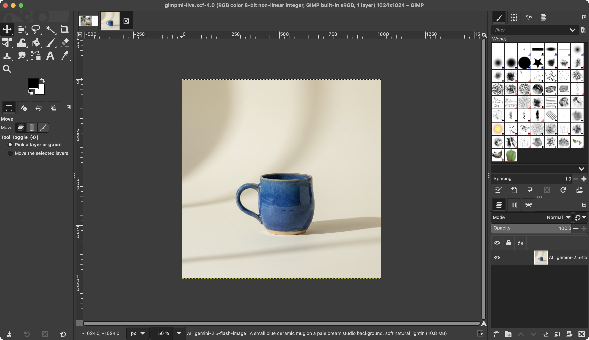

# GIMP-ML: Gemini image generation

A native **GIMP 3** plugin that turns a natural-language prompt into an image
and adds it to your document as a **new layer**. Choose Gemini through
**OpenRouter** or **Google's Gemini API**. Existing layers are not modified.

The legacy GIMP 2/Python 2 plugins, local neural-network models, OpenAI-only
pipelines, and Qt tray application have been removed.

## Plugin UI


Native plugin dialog captured in GIMP 3.2.4 on macOS.

### Generated output in GIMP



Actual 1024 × 1024 output generated through the installed plugin using Gemini
via OpenRouter. The canvas, GIMP tools, and generated layer are visible.

## Install

Requirements: GIMP 3.0 or newer, a separate Python 3.10+ installation with
`venv`/`pip`, internet access, and a funded API account.

From this repository:

```sh
python3 scripts/install.py
```

This creates `.venv`, installs the three backend dependencies, and copies the
plugin into your user's GIMP plugin directory, discovered from GIMP itself.
For GIMP 3.2 on macOS, this is
`~/Library/Application Support/GIMP/3.2/plug-ins`. It does not modify
`/Applications/GIMP.app` or install packages into GIMP's bundled Python.
For a custom installation:

```sh
python3 scripts/install.py --gimp "/path/to/gimp"
# Or bypass discovery:
python3 scripts/install.py --plug-in-dir "/your/GIMP/plug-ins"
```

Keep this repository at its installed location: the plugin records its
absolute path. Run the installer again after moving it or updating plugin code.
The installer only replaces its own `gimpml-gemini` plugin; it does not delete
other user-installed plugins.

## Credentials

Create `.env` in the repository root, or keep your existing one:

```dotenv
OPENROUTER_API_KEY=your-openrouter-key
GEMINI_API_KEY=your-google-gemini-key
```

Only the key for the selected provider is needed. Google also accepts
`GOOGLE_API_KEY`. Worker environment variables take precedence over `.env`.
The worker explicitly locates `.env`, so GIMP launched from Finder does not
need your terminal's environment.

**Do not put keys into `gimpml/config.json`.** `.env` files are ignored by Git.
Keys stay in the external API worker and are not written to layer names or logs.

## Use

1. Restart GIMP after installation.
2. Open a document, or generate without an open document to create one.
3. Choose **Filters > AI > Generate Image with Gemini...**.
4. Enter a prompt, such as "A cinematic mountain landscape at sunset."
5. Choose the provider, image model, aspect ratio, and resolution.
6. Click **Generate**. The generated image appears as a new top layer.

Native output size is preserved by default. **Fit image within canvas** scales
and centers the new layer while preserving aspect ratio; it does not resize
the canvas or stretch the image. Insertion into an existing document is one
undo operation. RGB and grayscale documents are supported; indexed documents
are not supported.

`gemini-2.5-flash-image` supports 1K output only. The other offered image models
support 1K, 2K, and 4K. Provider/model availability and supported capabilities
can change; an unavailable model produces an explicit error, not a fallback.
OpenRouter uses provider-prefixed model IDs internally; Google uses bare IDs.
Defaults and a 10-600 second timeout are configured in
[`gimpml/config.json`](gimpml/config.json).

Your **prompt** is sent to the selected external provider. This version does
not upload your canvas or layers, provide reference-image editing, or keep
conversation history. Generation can incur charges. Cancellation stops the
local worker and prevents layer insertion, but cannot guarantee the provider
stops processing or charging. No automatic retries or provider switching occur.

## Architecture

```text
GIMP 3 / GTK dialog
    -> short-lived Python worker (JSON over stdin/stdout)
        -> OpenRouter Image API or Google Gemini generateContent
        -> validated PNG in a private temporary directory
    -> GIMP file-load-layer / insert-layer
```

The native plugin uses GIMP's Python/GI runtime and standard library only.
The separate worker uses `requests`, `Pillow`, and `python-dotenv`. A persistent
HTTP server, localhost port, separate UI application, and GPU are unnecessary.
API errors are sanitized, response sizes are bounded, and temporary files are
removed on success, cancellation, or failure.

## Development and validation

```sh
.venv/bin/python -m unittest discover -s tests -v
```

On macOS, run the **offline** GIMP integration test:

```sh
/Applications/GIMP.app/Contents/MacOS/gimp \
  -n -d -f -s -c --batch-interpreter=python-fu-eval \
  -b "exec(open('$(pwd)/tests/gimp_smoke.py').read())" --quit
```

Provider tests mock HTTP responses; the GIMP test uses a local fixture and makes
no paid API requests. It checks registration, worker transport, native dialog
generation/cancellation, RGB/grayscale layer insertion, fitting, and new documents.
Tests do not prove live API account access or billing.
The integration test opens a temporary GIMP instance because dialogs and new
document displays cannot be tested with the console-only executable.

The procedure is also available noninteractively as `python-fu-gimpml-gemini`
with `prompt`, `provider`, `model`, `aspect-ratio`, `resolution`, and
`fit-to-canvas` arguments.

## License and citation

The project remains [MIT licensed](LICENSE.md). Provider terms apply to API use
and generated images. Google-generated images may include SynthID watermarks.

```bibtex
@article{soman2020GIMPML,
  title={GIMP-ML: Python Plugins for using Computer Vision Models in GIMP},
  author={Soman, Kritik},
  journal={arXiv preprint arXiv:2004.13060},
  year={2020}
}
```
